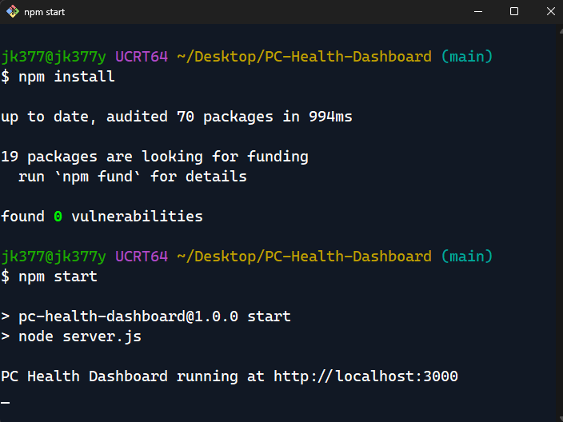
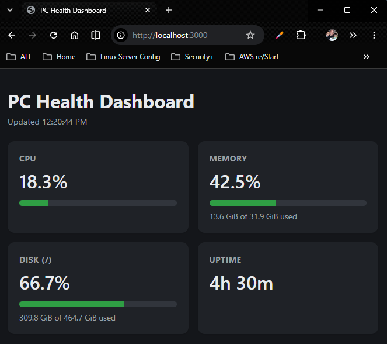
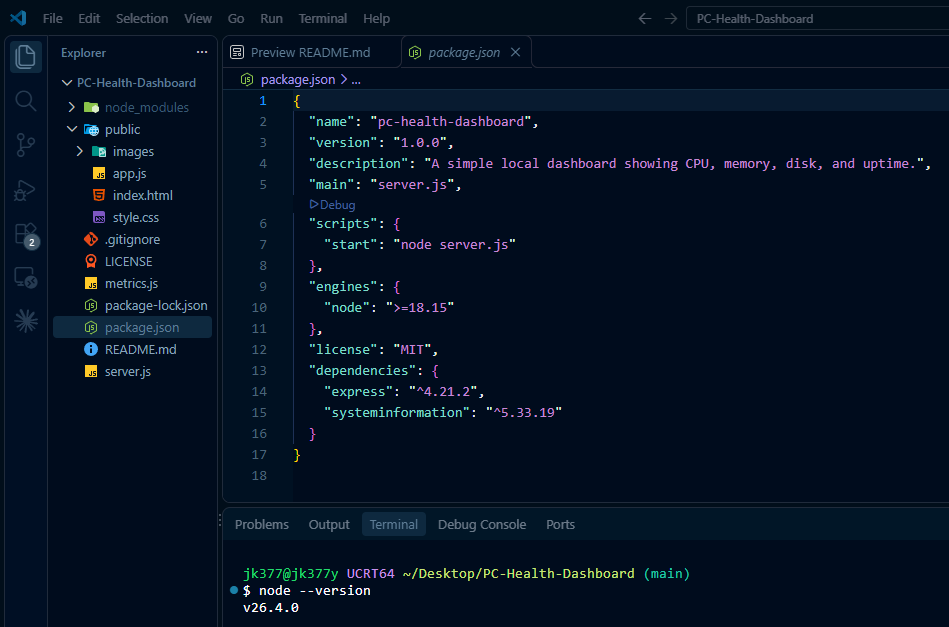
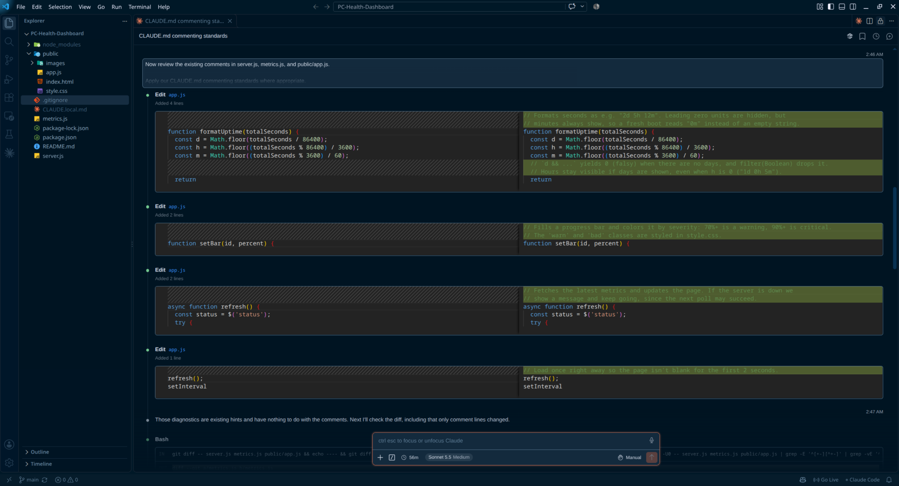

# PC Health Dashboard

A small local dashboard showing CPU, memory, disk usage, and uptime.
Built with Node.js, Express, and plain HTML/CSS/JS.

This project was also my first time using an AI agent (Claude Code) to build a complete, if small, application from start to finish. See [Built with an AI agent](#built-with-an-ai-agent) below.

## Features

- Live CPU, memory, and disk usage, refreshed every 2 seconds
- System uptime shown in days, hours, and minutes
- Progress bars that turn orange at 70% and red at 90%
- Only two runtime dependencies (Express and systeminformation), with no front-end framework or build step
- Listens on localhost only, so nothing is exposed to your network

## Install and run

You'll need [Node.js](https://nodejs.org) 18.15 or newer. To install it:

Command | OS
--- | ---
`sudo dnf install nodejs` | Fedora
`winget install OpenJS.NodeJS.LTS` | Windows

On Windows, open a new terminal after installing so it can find `node` and `npm`. Any terminal windows opened before installing will not have access to these commands.
You can verify the install by running `node --version` and `npm --version` in the terminal.

Open a terminal and make sure its working directory is the project's root folder. In the screenshot below, that's `~/Desktop/PC-Health-Dashboard`. Then run:

Then run `npm install`, followed by `npm start`, as shown below:



## View the dashboard

Once the app is running, as shown above, open http://localhost:3000 in your browser to watch your metrics live.



## Tools and versions

The Node.js row shows the version I used. The package rows show the version ranges declared in `package.json`.

| Tool | Version | Purpose |
| --- | --- | --- |
| [Node.js](https://nodejs.org) | `v26.4.0` | JavaScript runtime |
| [Express](https://expressjs.com) | `^4.21.2` | Web server and the `/api/metrics` route |
| [systeminformation](https://systeminformation.io) | `^5.33.19` | CPU usage, plus memory on macOS |



## How it works

- `metrics.js` reads CPU usage (and memory on macOS) with the `systeminformation` package, and everything else with Node's built-in `os`/`fs` modules.
- `server.js` serves `public/` and exposes `GET /api/metrics`.
- `public/app.js` polls that endpoint every 2 seconds and updates the page.

### Project structure

```
.
├── server.js        # Express server and the /api/metrics route
├── metrics.js       # CPU, memory, disk, and uptime readers
└── public/
    ├── index.html   # Dashboard markup
    ├── style.css    # Styling
    ├── app.js       # Polls the API and updates the page
    └── images/      # Images used in this README
```

### API

`GET /api/metrics` returns everything in one JSON response (the numbers below are just an example):

```json
{
  "cpu": { "percent": 12.4 },
  "memory": { "total": 16678203392, "used": 5368709120, "percent": 32.2 },
  "disk": { "total": 510405042176, "used": 183500000000, "percent": 36 },
  "uptimeSeconds": 93784
}
```

Byte values are in bytes. `cpu.percent` is `null` for the first second after the server starts, while the first reading is still being taken.

### Design notes

A few choices that are easy to get wrong with system metrics:

- **CPU** comes from `systeminformation`, which compares successive readings of the cumulative CPU times. The server asks it for a new value once a second on a timer. A single reading can't show current usage, and a timer means the result doesn't change with how many browser tabs are open.
- **Memory** uses `MemAvailable` from `/proc/meminfo` instead of `os.freemem()`. On Linux, "free" memory ignores disk cache that the kernel gives back on demand, so it makes a healthy machine look nearly full. macOS has the same problem, so there it uses the `available` value from `systeminformation`, refreshed every 2 seconds. Windows uses `os.freemem()`, which already counts that cache as available, and it's also the fallback if the other readings aren't available.
- **Disk** is calculated the same way `df` does it, so the percentage matches df on Linux.

Linux is the primary target. I've tested it on Fedora and Windows 11. I added `systeminformation` in the hope of supporting macOS too, but I haven't tested it there yet.

## Built with an AI agent

The goal of this project was to learn what it's like to build a real application with an AI agent. I used [Claude Code](https://claude.com/claude-code) inside VS Code. I described what I wanted, reviewed each change it proposed, and steered it as we went.

Beyond generating the application, I used Claude to plan the architecture, troubleshoot implementation issues, and review the code. I also tested the results independently against Fedora's System Monitor, and used the differences I found to correct inaccuracies in the metrics.

The screenshot below is from one part of that process. I had given Claude a set of commenting standards in a project instruction file, and asked it to review the existing comments and improve them without touching any executable code. Every edit shows up as a side-by-side diff that I can inspect before moving on.



A few things I learned along the way:

- An instruction file is a good place to put project rules (like commenting style) so you don't have to repeat them. I started with a `CLAUDE.md`, then renamed it to `CLAUDE.local.md` and excluded it from Git, because it holds my personal preferences rather than anything the project needs. That's why you won't find it in this repository.
- Reviewing the diff after each step keeps you in control, and it's how I confirmed the comment-only pass changed no code.
- Telling the agent not to commit or push until I say so keeps Git history under my control.

## About the author
### James Kelly, built with [Claude Code](https://claude.com/claude-code)

<a href="https://jk377y.dev" target="_blank">Portfolio</a> - <a href="mailto:jk377y@gmail.com">Email</a> - <a href="https://www.linkedin.com/in/james-kelly-cloud-engineer/" target="_blank">LinkedIn</a> - <a href="https://github.com/jk377y" target="_blank">GitHub</a>

## *License*
[](https://opensource.org/licenses/MIT)
<br>Copyright (c) 2026 James Kelly
<br>See the [LICENSE](LICENSE) file for the full text.
